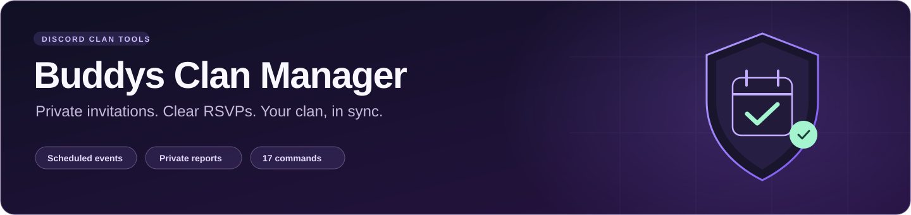

# Buddys Clan Manager

A Discord bot for Diablo Immortal clans: scheduled player DMs, Going / Not going
RSVPs, optional combat stats, automatic signup, and private manager reports.
Everything players and managers do happens inside Discord.

[Invite to a server](https://discord.com/oauth2/authorize?client_id=1561079116378406982&integration_type=0&scope=bot%20applications.commands&permissions=101392)
· [Setup guide](SETUP_README.md)
· [Hosting: AWS / Oracle / local](docs/HOSTING.md)
· [AWS operations](docs/AWS.md)

## All 17 slash commands

**Owner** = the Discord user configured as `BOT_OWNER_ID`.
**Managers** = that owner plus the leader/officers they assign in each server.
Vacant positions are allowed; knowing the application ID grants no management access.

| Command | Access | What it does |
| --- | --- | --- |
| `/clan-setup` | Owner | Create or repair the private manager channel and post the test launcher. |
| `/management` | Owner | Assign any available leader/officer positions. Blanks keep saved choices; `clear` removes a slot. |
| `/recipients` | Managers | Add or remove roles and individual players for a weekly schedule. |
| `/recipient-preview` | Managers | Privately review everyone who would receive a schedule's invitations. |
| `/schedule` | Managers | Edit invitation wording, preview it, then enable or pause a weekly schedule. |
| `/schedules` | Managers | View the weekly calendar, enabled/paused state, and saved target selections. |
| `/events` | Managers | List event dates, status, and event IDs. |
| `/report` | Managers | Refresh the full private RSVP list, stats, and DM delivery outcomes for an event. |
| `/correct` | Managers | Correct a player's RSVP or stats before event start; the change is audited. |
| `/cancel-event` | Managers | Confirm cancellation and notify delivered invitation recipients once. |
| `/announce` | Managers | Choose a recipient schedule, edit/preview a plain DM message, then send it now. |
| `/extra-event` | Managers | Preview and schedule an additional event with Going / Not going buttons. |
| `/audit` | Managers | View an event's response and correction history. |
| `/members` | Managers | View registrations, saved names, and welcome-message delivery failures. |
| `/test-bot` | Managers | Open private tests. Only the person testing receives test messages. |
| `/join-buddys` | Players | Confirm clan membership or update a saved in-game name. |
| `/rsvp` | Players | Privately list their own open invitations or answer one by event ID. |

**Send a message:** `/announce` → choose the recipient schedule → write the message
→ review the preview → confirm Send. Use `/extra-event` for RSVP buttons.
Use `/test-bot` to try the flow without contacting the clan.

## What you need to run it

Choose **one always-on host**. Production currently runs on AWS, independently of
the developer's PC. Oracle and local hosting are alternatives to that deployment.

| Host | Required | How it stays online |
| --- | --- | --- |
| **AWS** | An AWS project with EC2 access, a Linux VM, persistent disk, outbound HTTPS, and private Discord configuration. S3 and an instance role are needed for the supplied cloud backup service. | The current Ubuntu host uses systemd for startup and crash restart. Compute, disk, IPv4 and storage consume credits or incur charges under the selected plan. |
| **Oracle Cloud** | An Oracle Cloud account, a provisioned Linux VM, persistent disk, outbound HTTPS, Python, and private Discord configuration. | Use systemd on the VM. Historical Oracle files are included; the current build has not been redeployed there. |
| **Always-on local machine** | Python 3.11+ (3.12 tested), persistent storage, Internet access, and a computer that stays powered on and awake. | Keep the Python process running or configure a service/startup manager. Sleep, shutdown or lost Internet interrupts the bot. |

All options need a **Discord application/bot token**, your Discord user ID, a default
server ID, a **Guild Install**, and **Server Members Intent** enabled. No web dashboard,
public listening port, AI key, or separate database server is needed. The bot uses
SQLite. See [hosting instructions](docs/HOSTING.md) for configuration and commands.

Never run the same production token on two hosts at once. The process lock protects
one database on one host; it is not a cross-host lock.
**Pushing GitHub does not automatically update the running AWS bot.**

## Discord setup

1. Use **Guild Install / Add to Server** with `bot` and `applications.commands`.
2. Give the bot **View Channels, Send Messages, Read Message History, Attach Files,
   and Manage Channels**. Administrator is not required.
3. The configured bot owner joins the server and runs `/clan-setup`.
4. A server owner/administrator opens **#clan-management → Edit Channel → Permissions
   → Advanced permissions → buddysclanmanager**, allows **Manage Permissions**, and saves.
   This setting is inside the actual server, not the Developer Portal calculator.
   Owning the bot does not give your user permission to edit another person's server.
5. Run `/management` and fill whichever positions are available.
6. Players use `/join-buddys`, or managers select roles/users using `/recipients`.
   Review `/recipient-preview`, test privately, then enable each `/schedule` when ready.

Each server has independent managers, registrations, recipients, schedules and reports.
Only the configured owner assigns managers. New servers start with paused schedules;
automatic welcome DMs begin after setup. `CLAN_GUILD_ID` is the legacy/default server,
not an installation allowlist.

## Features

- **Automatic weekly invitations** with generated dates and editable messages.
- **Private RSVP DMs:** Going opens a stat form; Not going needs no stats.
- **Optional fields:** vacant manager slots and partial/all-blank stats save successfully.
  Blank text edits keep saved wording; blank signup names use the Discord display name.
- **Four stats:** armor, armor penetration, potency and resistance. Known values prefill
  future forms. Blanks show as **—**, never zero. Entered values must be nonnegative
  whole numbers; `5,000` is accepted.
- **New-member signup:** one Buddys membership question after joining a configured
  server. Confirmed members join future invitations. Existing members use
  `/join-buddys`; there is no mass welcome. Leaving deactivates registration.
- **Private manager reports:** full paginated recipient lists, RSVP totals, stats and
  delivery failures, refreshed on the normal 30-second scheduler tick.
- **Announcements, extra events, cancellations and audited corrections.**
- **Private test panel:** event, report, announcement, correction, cancellation, calendar
  and signup tests contact only the tester and use separate server/tester databases.
- **Multiple servers on one bot connection**, with fixed server scope for forms,
  DM buttons and permissions. Removing the bot pauses that server's schedules.
- **Persistent invitations and signup buttons** across restarts.
- **Retention:** live event history lasts 90 days; latest known stats remain.
  Backup copies retain older rows until their own rotation.
- **AWS daily private backups:** integrity-checked SQLite snapshots, local rotation
  and encrypted S3 upload. Keep an additional private copy outside AWS.

### Weekly calendar

| Invitation DM | Event | Event starts |
| --- | --- | --- |
| Wednesday, 5 PM | Shadow War | Thursday, 8 PM |
| Friday, 5 PM | Shadow War | Saturday, 8 PM |
| Saturday, 5 PM | Rite of Exile / Vigil of Blades | Sunday, 8 PM |

All times are **America/New_York**, including daylight saving changes.
There are **no automatic reminders**. Schedules may be saved before positions or
recipients are filled; an empty recipient list sends no DMs. Registrations apply
to future recipient snapshots. Responses and corrections close at event start.

## Reliability and privacy

Recipients are saved before dispatch. Missed sends catch up only before event start.
Sent, failed and uncertain deliveries are not blindly resent. A network failure
between Discord accepting a message and SQLite recording it cannot guarantee
exactly-once delivery; uncertain outcomes are visible for manager review.

The bot checks report-channel privacy and pauses delivery if its access list is
exposed. Discord server owners and Administrators can bypass channel permissions.
Membership is self-reported; registration does not grant roles, management access,
or an automatic Going RSVP.

## Development and AWS changes

Runtime: Python + discord.py + SQLite. `bot.py` owns Discord flows and scheduling;
`clan.py` owns storage, calendar and rules; `instance_lock.py` provides the process lock.
`requirements-frozen.txt` contains the tested runtime dependency versions.

The last code validation passed **97 automated tests**, including mocked external calls.
The owner reported the bot working on **October 18, 2026**; this is separate from
claiming every player flow was independently tested end to end.

```bash
python -m unittest discover -s tests -v
```

For an AWS change: back up production → edit/test → commit/push → stage reviewed code
on the host → preserve private configuration and live DB → restart `guild-bot` →
verify Gateway, command sync and `/test-bot`. See [AWS operations](docs/AWS.md) and
[hosting/update procedures](docs/HOSTING.md). A new AWS service also needs a
same-Region design, current plan/cost check, scoped role permissions and validation
before enabling player-facing sends. GitHub Actions auto-deployment is not configured.

Never commit tokens, cloud credentials, `.env`, databases, backups or player logs.
Operational handoff/log files stay local through `.gitignore`.
The [original Oracle project description](docs/ORIGINAL_README.md) is preserved
as historical context.
